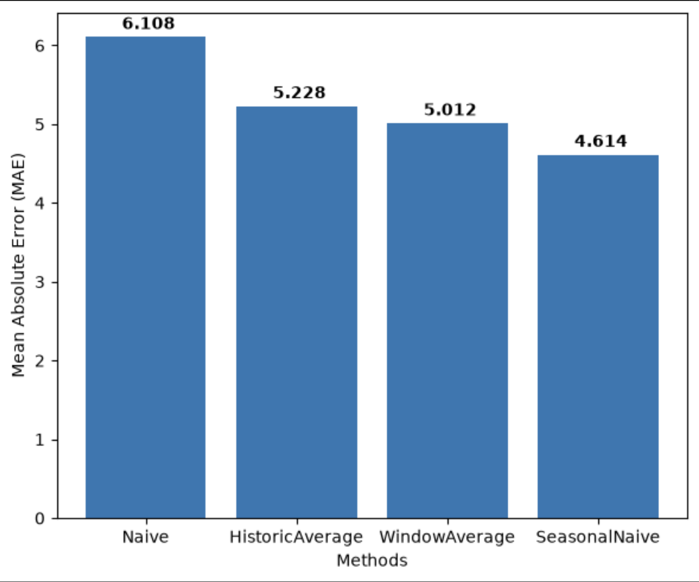
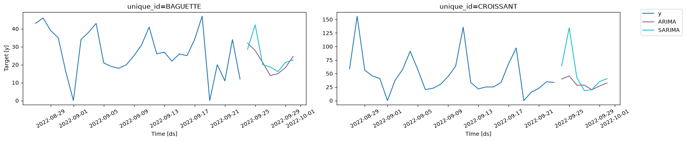
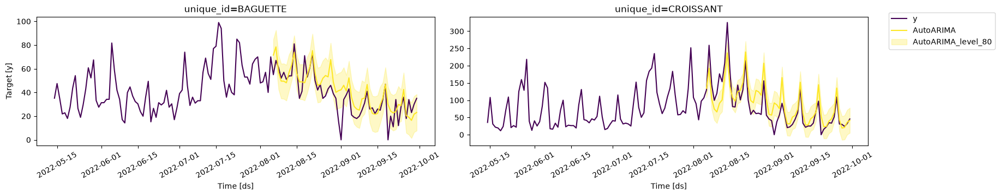
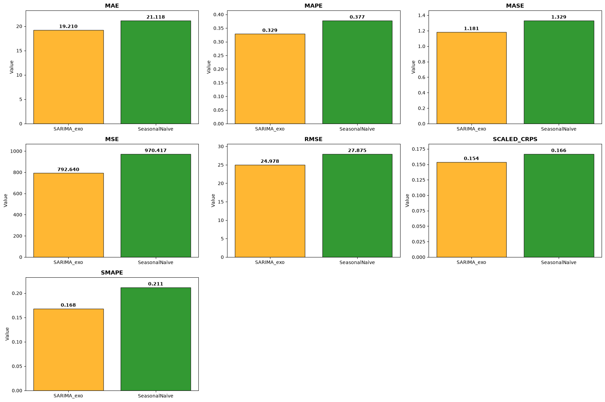

# Time Series Analysis with Statistical Models

<p align="center">  </p>


## Overview

This project explores time series forecasting using statistical models, with a focus on understanding temporal patterns, evaluating forecasting accuracy, and quantifying prediction uncertainty.

The notebook covers fundamental forecasting techniques and more advanced approaches, including ARIMA/SARIMA models, exogenous variables, feature engineering, and time-based cross-validation.

The objective is to compare different forecasting approaches and investigate whether incorporating external explanatory variables can improve predictive performance.

## Environment Setup

<!-- The project uses Python 3.12 and the following libraries:

- `StatsForecast` – Statistical time series forecasting models.
- `UtilsForecast` – Forecast evaluation and utility functions.
- `Pandas` – Data manipulation and analysis.
- `NumPy` – Numerical computations.
- `Matplotlib` – Data visualisation. -->

### 1. Create and activate the environment

```bash
conda create -n time_series_analysis_env python=3.12
conda activate time_series_analysis_env
```

### 2. Install dependencies

```bash
pip install -r requirements.txt
```

### 3. Launch the notebook

If Jupyter is not already installed:

```bash
pip install jupyterlab ipykernel
```

Launch JupyterLab:

```bash
jupyter lab
```

## Dataset Description
Item	Description
Forecasting target	[Target variable]
Time frequency	[Daily / Weekly / Monthly]
Exogenous variables	Unit price and other relevant variables
Forecast horizon	[Number of periods ahead]
Data period	[Start date – End date]

| Column | Description |
|---|---|
| unique_id | Product name |
| ds | Timestamp (Time series column) |
| y | Total Sales of the Product that day (Target variable) |
| unit_price | Price of each unit of the product (Exogenous variable)  |

There are around `57,000 records` in the dataset, with around `150 unique products`. The the records are from `Jan 2021 to Sept 2022`.

The data is recorded on a `daily basis`. We are producing forecasts for the next 7 days (`forecast horizon = 7`) on a daily basis. 


## Notebook Contents

The notebook covers the following topics:

### 1. Baseline Forecasting Models

Implementation and comparison of three fundamental forecasting approaches:

- **Historic Mean:** Uses the historical average as the forecast for future observations.
- **Naive Forecast:** Uses the most recent observed value as the forecast.
- **Seasonal Naive:** Uses the value from the corresponding period in the previous season.

These models establish baseline performance against which more advanced forecasting approaches can be evaluated.

<p align="center">  </p>

Since SeasonalNaive has the lowest MAE error, we will choose that as our baseline model to evaluate the performance of the advanced models.

### 2. ARIMA / SARIMA Models

Implementation of AutoRegressive Integrated Moving Average (ARIMA) and Seasonal ARIMA (SARIMA) models.

Explores how these statistical models capture:
- Autoregressive patterns.
- Trends and non-stationarity through differencing.
- Moving average components.
- Seasonal patterns and dependencies.

<p align="center">  </p>

### 3. Time Series Cross-Validation

Using time-based cross-validation windows to evaluate forecasting performance across multiple periods.

This provides a more reliable assessment of model generalisation while preserving the chronological order of observations and avoiding data leakage.

### 4. Exogenous Features and Feature Engineering

Incorporating external explanatory variables to potentially improve forecasting accuracy.

Topics include:
- Exogenous variables (e.g., unit price).
- Feature engineering.
- Fourier terms to capture seasonal patterns.

The objective is to investigate whether additional information beyond historical observations can improve forecast performance.

### 5. Prediction Intervals

Generating prediction intervals to quantify uncertainty around point forecasts.

This provides insight into the range of plausible future outcomes rather than relying exclusively on a single predicted value.

<p align="center">  </p>

### 6. Forecast Evaluation Metrics

Comparing model performance using several evaluation metrics:

| Metric | Description |
|---|---|
| MAE | Mean Absolute Error |
| MSE | Mean Squared Error |
| RMSE | Root Mean Squared Error |
| MAPE | Mean Absolute Percentage Error |
| SMAPE | Symmetric Mean Absolute Percentage Error |
| MASE | Mean Absolute Scaled Error |
| CRPS | Continuous Ranked Probability Score |

These metrics provide complementary perspectives on forecasting accuracy and probabilistic performance.

## Model Comparison

The notebook evaluates the forecasting models (SARIMA with expogenous variable and Seasonal naive model) using the selected error metrics to identify which approach provides the most accurate predictions.

The comparison focuses on:
- Forecasting accuracy.
- Relative performance against baseline model.
- Prediction uncertainty.
- The potential benefit of incorporating exogenous variables.

Here are the evaluation results:

<!-- | Metric | SARIMA_exo | SeasonalNaive |
|---|---:|---:|
| MAE | 19.210 | 21.118 |
| MAPE | 0.329 | 0.377 |
| MASE | 1.181 | 1.329 |
| MSE | 792.640 | 970.417 |
| RMSE | 24.978 | 27.875 |
| Scaled CRPS | 0.154 | 0.166 |
| SMAPE | 0.168 | 0.211 | -->


<p align="center">  </p>

### *Inference:*   
- The SARIMA_exo model outperforms the SeasonalNaive benchmark across all seven forecasting metrics.
- Incorporating the `unit_price` exogenous variable improves the model's forecasting accuracy and probabilistic performance compared with relying solely on seasonal patterns.
- However, if we look at the MASE metric, both models exceed 1, which can indicate that both models perform worse than the benchmark used to scale the errors.


## Tools and Technologies

- Python 3.12
- StatsForecast
- UtilsForecast
- Pandas
- NumPy
- Matplotlib
- Jupyter Notebook / JupyterLab

## Future Improvements

Potential extensions to this project include:

- Exploring additional statistical forecasting models.
- Comparing statistical models with machine learning approaches.
- Optimising model hyperparameters.


